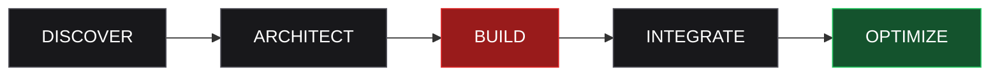

 

# BUILDING INTELLIGENT SYSTEMS.
### AUTOMATING BUSINESS GROWTH.

I design, build, and optimize powerful GoHighLevel and AI automation systems that help businesses streamline operations, capture more leads, and scale with confidence.

 

---

## ◈ ABOUT ME

I'm **Adnan Jameel**, a GoHighLevel Expert and AI Automation Specialist with **2+ years of hands-on experience** building, integrating, and optimizing business automation systems.

My work focuses on transforming manual processes into intelligent, connected, and scalable systems.

I don't just build workflows. I engineer complete automation ecosystems designed around real business needs.

---

## ◈ CORE EXPERTISE

<table>
<tr>
<td width="50%" valign="top">

### 01 / GOHIGHLEVEL

- Complete CRM Architecture
- Funnels & Website Development
- SaaS Mode & Snapshots
- Pipelines & Opportunity Management
- Calendars & Appointment Systems
- Sub-account Setup & Configuration

</td>
<td width="50%" valign="top">

### 02 / AI AUTOMATION

- AI Voice Agents
- AI Chat Agents
- Intelligent Lead Qualification
- Automated Appointment Booking
- Conversational AI Systems
- AI-powered Customer Support

</td>
</tr>
<tr>
<td width="50%" valign="top">

### 03 / WORKFLOW ENGINEERING

- Advanced GHL Workflows
- Lead Nurturing Systems
- Appointment Reminders
- No-show Recovery
- Review Automation
- Custom Automation Logic

</td>
<td width="50%" valign="top">

### 04 / API & INTEGRATIONS

- REST API v2
- Custom API Integrations
- Webhooks & Event Automation
- n8n & Zapier
- Make Automation
- Google Sheets Integrations

</td>
</tr>
</table>

---

## ◈ TECHNOLOGY STACK

---

## ◈ HOW I WORK

Every project follows a structured approach:

- Understand business goals and requirements.
- Design a scalable automation architecture.
- Build and configure the required systems.
- Connect APIs and external platforms.
- Test, troubleshoot, and optimize performance.

---

## ◈ WHAT I BRING TO YOUR BUSINESS

| BUSINESS CHALLENGE | MY SOLUTION |
|---|---|
| Leads going cold | Automated lead nurturing |
| Manual follow-ups | Intelligent AI workflows |
| Missed appointments | Booking & reminder automation |
| Disconnected systems | API & webhook integrations |
| CRM inefficiencies | Optimized GoHighLevel architecture |
| Repetitive operations | End-to-end business automation |

---

## ◈ LET'S BUILD SOMETHING POWERFUL

### YOUR NEXT AUTOMATION PROJECT STARTS HERE.

Whether you need a complete GoHighLevel setup, AI Voice Agent, intelligent chatbot, custom integration, or workflow optimization — let's make it happen.

 

  

**2+ YEARS EXPERIENCE**

*Available for freelance projects and professional opportunities.*

*Flexible working hours with full overlap for US and UK time zones.*

 

ADNAN JAMEEL · GOHIGHLEVEL EXPERT · AI AUTOMATION SPECIALIST

